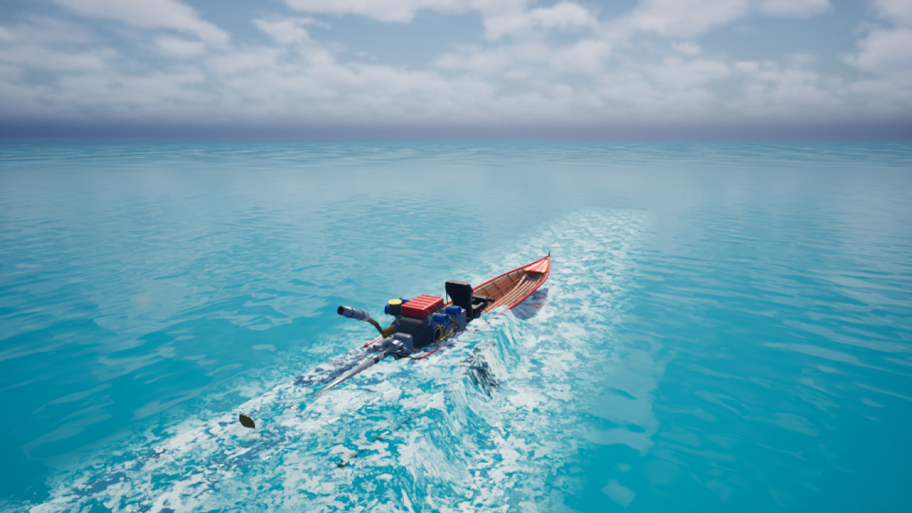
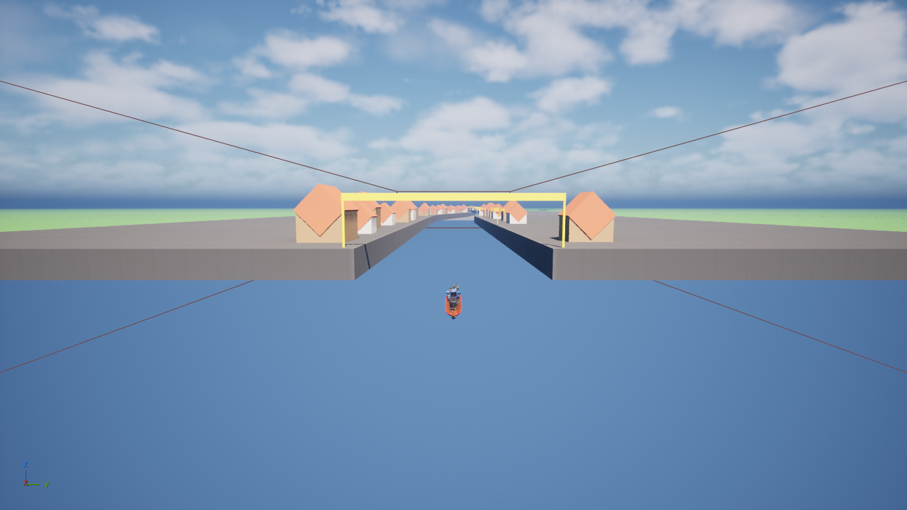

<div align="center">

# BoatlRacing

**เกมแข่งเรือหางยาวไทยบน Unreal Engine 5**

ต้นแบบที่ขับได้จริง พร้อมฟิสิกส์ลอยตัว น้ำที่แหวกตามเรือ ละอองน้ำ และเสียงเครื่องยนต์




</div>

## เกี่ยวกับโปรเจค

BoatlRacing คือต้นแบบเกมแข่งเรือหางยาวในคลองไทย ตอนนี้มีเรือ 1 ลำที่ขับได้ครบวงจร ตั้งแต่ฟิสิกส์ น้ำ เอฟเฟกต์ ไปจนถึงเสียง และมีคลองทดสอบยาว 1.85 กม. ให้ลองวิ่ง

> [!NOTE]
> โปรเจคยังอยู่ในขั้นต้นแบบ ยังไม่ใช่เกมที่พร้อมวางขาย ดูสิ่งที่ยังไม่เสร็จได้ที่หัวข้อ [ข้อจำกัดที่รู้อยู่](#known-issues)

## สิ่งที่มีแล้ว

| ระบบ | รายละเอียด |
| --- | --- |
| **เรือ** | เรือหางยาวแข่ง ประกอบจาก mesh 98 ชิ้น มีจุดหมุนให้เลี้ยว ยกแกนใบพัด และหมุนใบพัดได้จริง |
| **การขับ** | Pawn ฟิสิกส์ที่ลอยตัวด้วย pontoon ความเร็วสูงสุดราว 110 กม./ชม. จูนค่าได้จาก Data Asset โดยไม่ต้องแก้ Blueprint |
| **น้ำ** | Water plugin ของ UE ร่วมกับปลั๊กอิน C++ `BoatlRacingPhysics` ที่อ่านระดับน้ำและจำลองระลอกคลื่นรอบเรือ |
| **เอฟเฟกต์** | โฟมท้ายเรือ ละอองน้ำหัวเรือและข้างเรือ น้ำพุ่งจากใบพัด และควันท่อไอเสีย ทำด้วย Niagara |
| **เสียง** | เครื่องยนต์ MetaSound แบ่ง 4 ช่วงรอบ มี 2 โปรไฟล์ (สปอร์ตคาร์และหางยาว) พร้อมเสียงน้ำ เสียงชน และบรรยากาศคลอง |
| **แผนที่** | คลองทดสอบ 1 แผนที่ และแผนที่ทดสอบน้ำ 3 แบบ |
| **เมนูและโชว์รูม** | เมนูหลักตามภาพ `UI_REF`, โชว์รูมเลือกเรือ 2 ลำ เครื่องยนต์ 4 แบบ (มีผลกับแรงขับและความเร็วจริง) และ HUD ระหว่างขับ ทั้งหมดเป็น Blueprint ดู [FRONTEND_SCENES](Docs/Guides/FRONTEND_SCENES.md) |

## เริ่มใช้งาน

### สิ่งที่ต้องมี

| โปรแกรม | หมายเหตุ |
| --- | --- |
| **Unreal Engine 5.8.3** | ติดตั้งจาก Epic Games Launcher |
| **Git และ Git LFS** | โมเดล texture เสียง และแผนที่เก็บผ่าน LFS ถ้าไม่มี LFS ไฟล์จะเปิดไม่ได้ |
| **ปลั๊กอิน CMC_PLUS** | เปิดใช้อยู่ใน `.uproject` ให้ติดตั้งเข้า engine ผ่าน Epic Games Launcher ก่อนเปิดโปรเจค ([เอกสารปลั๊กอิน](https://venty.gitbook.io/cmc-plus)) |
| Visual Studio 2022 | ไม่บังคับ ใช้เมื่อแก้โค้ด C++ หรือเมื่อ engine ไม่ใช่ 5.8.3 |

### ติดตั้ง

```bash
git lfs install
git clone https://github.com/covaverse/BoatlRacing.git
```

จากนั้นดับเบิลคลิก `BoatlRacing.uproject`

เปิดครั้งแรกจะใช้เวลานาน เพราะ UE ต้องสร้าง shader และ cache ใหม่ในเครื่อง (โฟลเดอร์ `Intermediate/`, `Saved/` และ `DerivedDataCache/` ซึ่งไม่ได้เก็บใน git)

### ลองขับ

1. โปรเจคจะเปิดที่เมนูหลัก `M_MainMenu` กด **Play** แล้วเลือก GARAGE เพื่อเลือกเรือและเครื่องยนต์ หรือ PLAY / RACE เพื่อเลือกสนาม
2. ถ้าจะขับทันที ให้เปิด `M_WaterPhysicsTest` หรือ `M_CanalBlockout` แล้วกด **Play** และคลิกใน viewport หนึ่งครั้งเพื่อให้รับคีย์บอร์ด

## ปุ่มควบคุม

| ปุ่ม | การทำงาน |
| :---: | --- |
| <kbd>W</kbd> / <kbd>S</kbd> | เดินหน้า / ถอยหลัง |
| <kbd>A</kbd> / <kbd>D</kbd> | เลี้ยวซ้าย / เลี้ยวขวา |
| <kbd>Q</kbd> / <kbd>E</kbd> | กดแกนใบพัดลง / ยกแกนใบพัดขึ้น |
| <kbd>Space</kbd> | ปลดคลัตช์ |
| <kbd>C</kbd> | เปลี่ยนมุมกล้อง |

## แผนที่



| แผนที่ | ใช้ทำอะไร |
| --- | --- |
| `Maps/M_MainMenu` | แผนที่เริ่มต้น เมนูหลัก |
| `Maps/M_Garage` | โชว์รูมเลือกเรือและเครื่องยนต์ |
| `Maps/M_WaterPhysicsTest` | น้ำเรียบ ใช้ทดสอบการขับและฟิสิกส์ |
| `Maps/M_CanalBlockout` | คลองยาว 1.85 กม. กว้าง 30 ม. มีสะพาน 2 แห่ง บ้านริมคลอง และป้ายบอกระยะทุก 100 ม. |
| `Maps/M_WaterSmallWavesTest` | ทดสอบเรือกับคลื่นเล็ก |
| `Maps/M_WaterHighWavesTest` | ทดสอบเรือกับคลื่นสูง |

## โครงสร้างโปรเจค

```text
BoatlRacing/
├── BoatlRacing.uproject      ไฟล์เปิดโปรเจค
├── Config/                   การตั้งค่าโปรเจคและ editor
├── Content/
│   ├── Boats/ThaiLongtail/   เรือ: โมเดล Blueprint การขับ เอฟเฟกต์ เสียง
│   ├── Maps/                 แผนที่ทั้งหมด
│   └── Water/                material และค่าตั้งของน้ำ
├── Plugins/
│   └── BoatlRacingPhysics/   ปลั๊กอิน C++ สำหรับน้ำและการลอยตัว
├── SourceAssets/             ไฟล์ต้นฉบับก่อน import (.glb, .obj, .wav)
├── Tools/                    สคริปต์ Python สำหรับสร้างและตรวจ asset ใน editor
└── Docs/                     คู่มือ แผนงาน และบันทึกการทำงาน
```

ไฟล์สำคัญที่ใช้บ่อย:

| ไฟล์ | หน้าที่ |
| --- | --- |
| `Content/Boats/ThaiLongtail/Blueprints/BP_LongtailPhysicsPawn` | เรือที่ผู้เล่นขับ รวมฟิสิกส์ กล้อง เอฟเฟกต์ และเสียง |
| `Content/Boats/ThaiLongtail/Blueprints/BP_ThaiLongtailBoat` | ตัวเรือที่ประกอบจากชิ้นส่วน |
| `Content/Boats/ThaiLongtail/Handling/DA_ThaiLongtail_Handling` | ค่าจูนการขับ เช่น มวล อัตราเร่ง แรงต้าน และการเลี้ยว |

## ทำงานร่วมกัน

ไฟล์ `.uasset` และ `.umap` เป็นไฟล์ binary ที่ git รวมการแก้ไขจากสองคนไม่ได้ ถ้าสองคนแก้ไฟล์เดียวกัน ต้องเลือกเก็บของคนใดคนหนึ่ง จึงขอให้ทำตามนี้:

1. **ปิด UE แล้ว `git pull` ก่อนเริ่มงานทุกครั้ง**
2. **บอกทีมก่อนว่าจะแก้ไฟล์ไหน** โดยเฉพาะแผนที่และ Blueprint ของเรือ
3. **กด Save All ใน UE** แล้วจึง commit

```bash
git pull
# ...ทำงานใน UE แล้ว Save All...
git add .
git commit -m "อธิบายสั้น ๆ ว่าแก้อะไร"
git push
```

> [!WARNING]
> ข้อควรระวังเฉพาะโปรเจคนี้
> - **อย่า compile Blueprint หรือ save ระหว่างกด Play** งานอาจไม่ถูกบันทึกและโฟมน้ำจะหาย
> - **อย่าสร้างหรือแก้แผนที่แบบ headless** น้ำจะไม่แสดงผลและแก้กลับไม่ได้ ให้รันสคริปต์ใน `Tools/` จาก editor ที่เปิดอยู่เท่านั้น
> - **แก้โค้ด C++ แล้วต้อง build และ commit ไฟล์ DLL ใน `Plugins/BoatlRacingPhysics/Binaries/` ด้วย** ไม่งั้นคนที่ไม่มี Visual Studio จะเปิดโปรเจคไม่ได้

## เอกสาร

| เอกสาร | อ่านเมื่อ |
| --- | --- |
| [สารบัญคู่มือ](Docs/README.md) | อยากเห็นเอกสารทั้งหมด |
| [แผนผังโปรเจค](Docs/Guides/PROJECT_MAP.md) | หาว่าระบบไหนอยู่ไฟล์ไหน |
| [คู่มือ Handling](Docs/Guides/HANDLING_GUIDE.md) | จูนการขับของเรือ |
| [คู่มือเสียง](Docs/Guides/AUDIO_GUIDE.md) | เปลี่ยนหรือปรับเสียง |
| [โครงสร้างประกอบเรือ](Docs/BOAT_ASSEMBLY.md) | ดูชิ้นส่วนและจุดหมุนของเรือ |
| [ฟิสิกส์น้ำ](Docs/WATER_PHYSICS.md) | เข้าใจการลอยตัวและแรงที่กระทำกับเรือ |
| [สถานะปัจจุบัน](Docs/STATUS.md) | ตรวจว่าอะไรเสร็จและอะไรยังไม่ผ่านการทดสอบ |

<a name="known-issues"></a>

## ข้อจำกัดที่รู้อยู่

- น้ำยังล้นเข้าในลำเรือได้เมื่อระดับน้ำสูงกว่าขอบเรือ
- แผนที่คลื่นสูงยังไม่ผ่านการทดสอบ
- ชนตลิ่งด้วยความเร็วสูงแล้วเรืออาจติดอยู่กับผนัง
- ระบบกันน้ำเข้าลำเรือรองรับเรือได้ 1 ลำต่อแผนที่

รายละเอียดและงานที่ค้างทั้งหมดอยู่ใน [Docs/STATUS.md](Docs/STATUS.md)

## เครดิตเสียง

เสียงเครื่องยนต์และท่อไอเสียบางส่วนใช้สัญญาอนุญาต Creative Commons ที่ต้องแสดงที่มา:

- "Car Engine Loop" โดย qubodup, CC-BY 3.0, [OpenGameArt](https://opengameart.org/content/car-engine-loop-96khz-4s)
- "Lextek XP13C Exhaust Sound - Kawasaki ZX-6R 2014" โดย Lextek Products, CC-BY 3.0, ผ่าน Wikimedia Commons
- "Maserati GranTurismo S Exhaust" โดย lmartins, CC BY 4.0, ผ่าน Wikimedia Commons
- "Ferrari 250 GTO, Engine Sound" โดย Provo rossi, CC BY 4.0, ผ่าน Wikimedia Commons

รายการไฟล์เสียงทั้งหมดพร้อมที่มาอยู่ใน [SourceAssets/Audio/Real/CREDITS.md](SourceAssets/Audio/Real/CREDITS.md)
